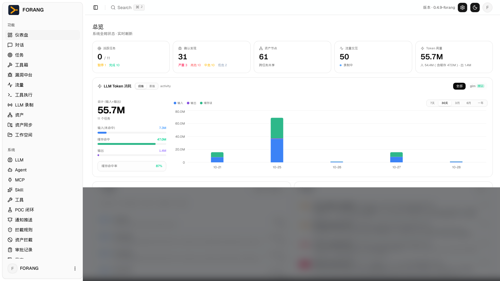
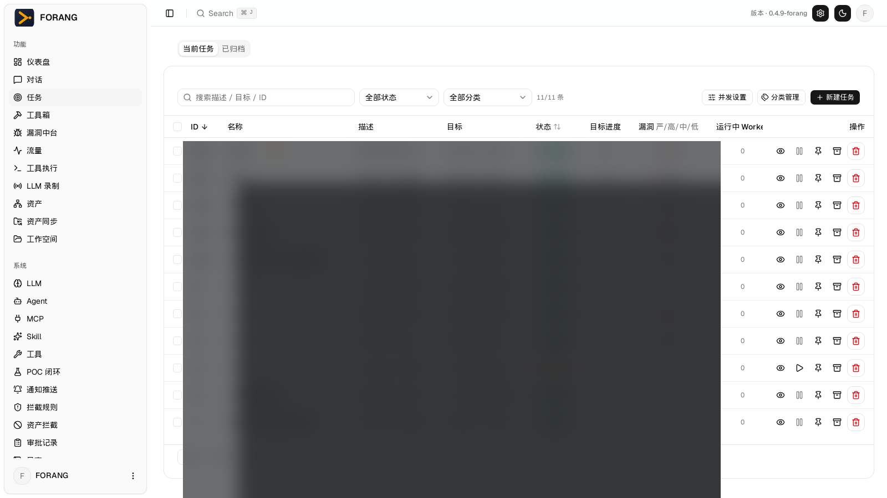
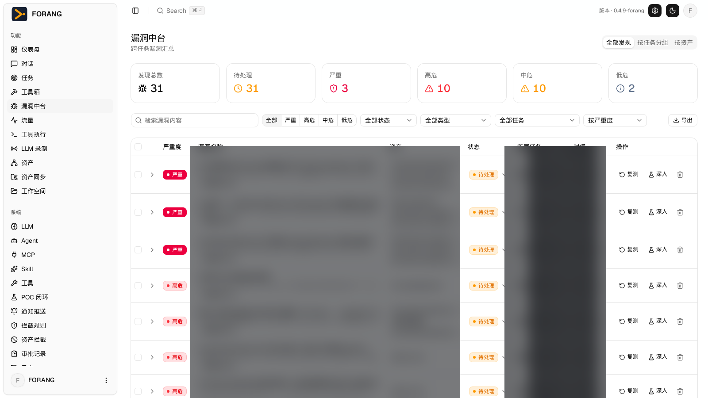
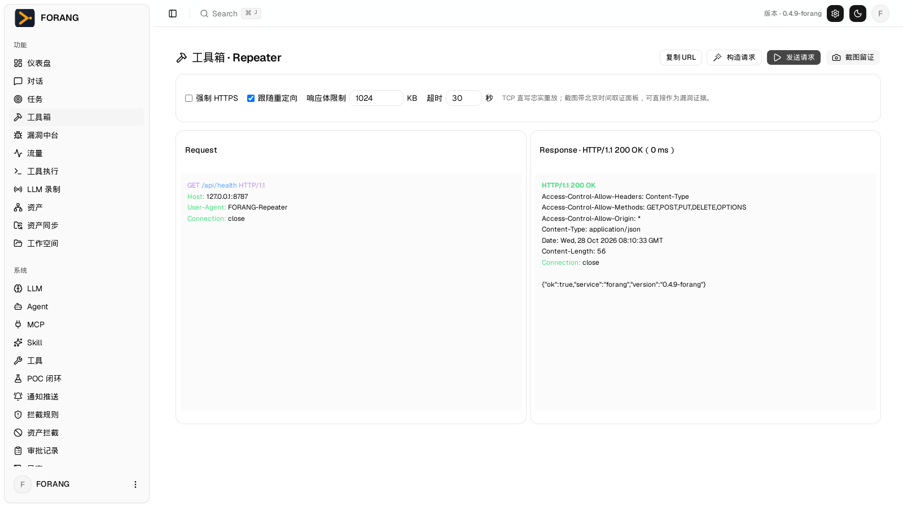
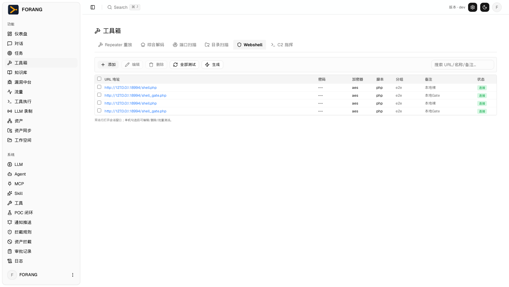
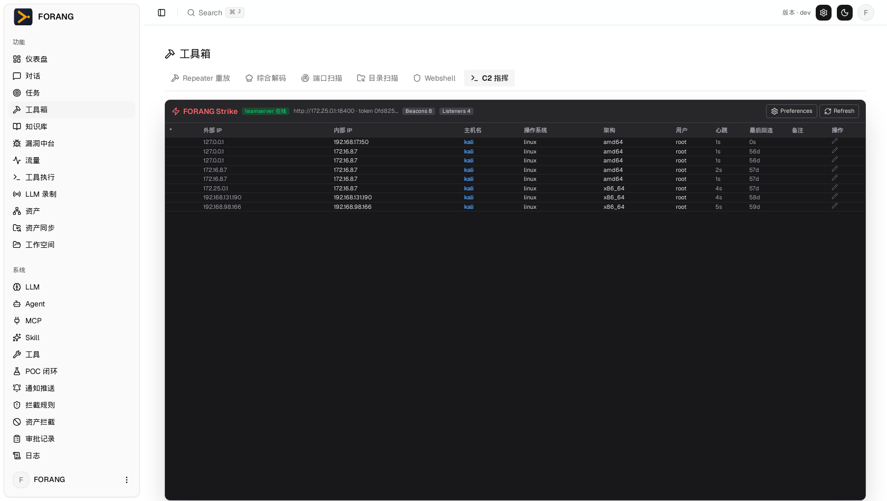
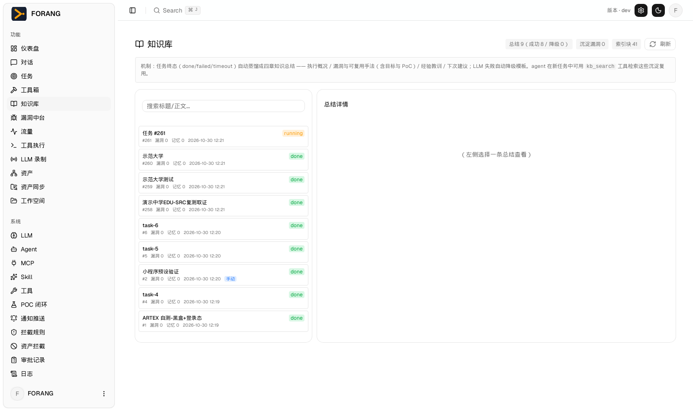
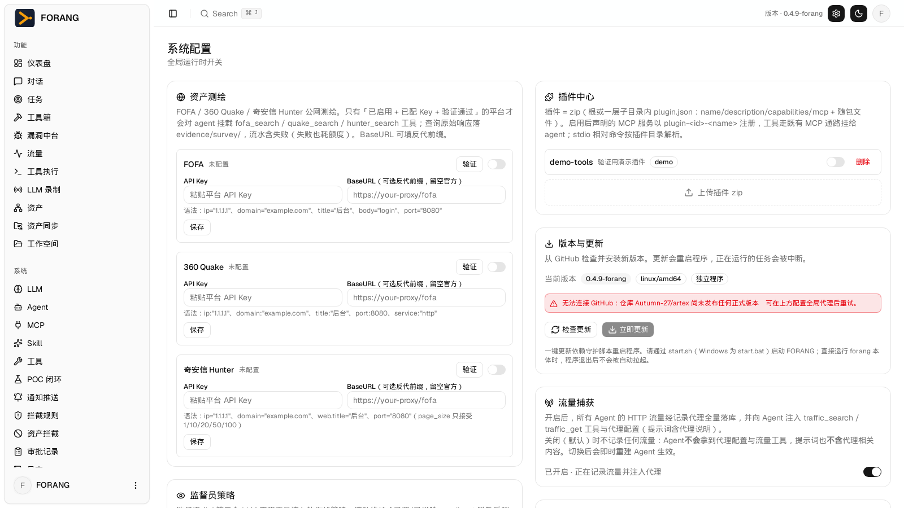

# FORANG — 自主渗透测试平台

> FORANG 是一个面向授权渗透测试（SRC / 护网 / 企业授权评估）的 **Agent 驱动自动化测试平台**。
> 它把「会思考的 LLM Agent」和「专业渗透工具链」装配在一起：规划 agent 拆解目标、执行 agent
> 驱动真实工具完成侦察、验证、留证与报告，人对关键动作保留审批权。

- 前身：ARTEX 0.3.15 二开版，深度吸收「全链哨兵 Full-Chain-Sentinel-System」（MIT）的
  漏洞中台、frida 脚本库、资产测绘、审批治理、replayd 发包留证等能力。
- 技术栈：Go 单二进制（内嵌 Next.js 静态导出前端，`-tags embedui`）+ PostgreSQL。
- 部署形态：Linux 宿主机直跑（亦可容器化）。Web 服务 `:8787`，流量录制代理 `127.0.0.1:8788`。

---

## 截图预览

> 截图数据已演示化/打码处理。

| 仪表盘（总览 / Token 消耗 / 缓存命中） | 任务列表（多 Agent 任务） |
| :---: | :---: |
|  |  |
| **漏洞中台**（发现汇总 / 评审 / 复测 / 导出） | **工具箱 · Repeater**（原始报文重放 + 留证截图） |
|  |  |
| **Webshell 管理器**（哥斯拉式目标表 + 会话工作台） | **C2 指挥台**（CS 式会话表 + Beacon Console） |
|  |  |
| **知识库 · 字典中心**（五类字典沉淀复用） | **系统配置**（测绘 / 插件 / 更新 / 流量捕获） |
|  |  |

---

## 一、渗透任务引擎（多 Agent 协同）

平台的核心执行单元。一个任务 = 一个探索图 + 一组协同 Agent：

| 角色 | 职责 |
|------|------|
| planner | 拆解目标为意图（intent），调度 worker，复盘收敛 |
| worker | 单意图执行：侦察、验证、写回证据、报漏洞 |
| mainagent | 人机对话主控（对话工作台后端） |
| goals | 目标拆解器（set_goals / set_constraints） |
| reporter / retester | 报告撰写 / 漏洞复测 |
| pentest | 独立渗透 agent（自带测绘、frida、droid 工具集） |

能力点：

- **探索图持久化**：节点/意图/work 证据全量入库，跨 work 回看（search_all_worker_traces / get_worker_trace / node_detail）。
- **实时纠偏**：`steer_work` 对运行中的意图注入指令，不打断不丢进展；`set_goals` / `set_constraints` 运行时补充目标与操作边界（allow/deny）。
- **预算与收尾**：步数/时长/Token 预算，预算触发生成收尾总结（settlement）。
- **操作约束注入**：约束系统自动注入 planner/worker，收敛探索边界。
- **任务容器化**（可选开关）：每个任务的 Bash 在独立 Docker 容器（kali-rolling）内执行，同路径挂载工作目录，任务结束容器回收。
- **三端预设 Agent**：微信小程序 / 移动 APP / Web 三套方法论预设，创建任务或对话时选择即注入（不改工具权限，只改作战方法）。
- **任务结果清理与归档**：按任务删除流量/文件/漏洞/LLM 记录（破坏性操作可审计）；任务快照导出与恢复。

## 二、对话工作台

与任意 Agent（内置或自定义）实时对话的指挥台：

- **附件上传**：文件落到会话工作目录 `uploads/`，agent 直接读取使用。
- **载体即传即测**：发来 wxapkg / 反编译源码 zip / APK / IPA / HAR，说一句「解析这个包」，
  agent 调用 `carrier_parse` 立即得到 appid、页面清单、后端域名、API 端点、硬编码密钥，随即开测。
- **工具箱 Repeater / 发包留证截图**：内置 Repeater 页面（原始报文 TCP 直写忠实重放、
  构造请求、强制 HTTPS、跟随重定向、响应体限制）；agent 侧 `repeater_send` / `repeater_capture`
  发送报文并截取带时间取证页（请求 | 响应 | 北京时间取证面板）。截图内联显示在对话流中，
  **模型也能亲眼看到截图**（视觉自检），并可绑进漏洞证据。
- **网页截图**：`web_screenshot`（Chromium headless，支持整页）。
- **模型/预设/条令选择**：会话级选择 LLM 档案、三端预设、指挥条令；选择持久记忆。
- **会话管理**：transcript 全量持久化、多轮续聊、上下文压缩、`steer` / `stop`。

## 三、漏洞中台

漏洞从提交到报告的完整生命周期：

- **提交**：`vuln_submit`（标题清洗、严重级别、复现步骤、原始数据包、证据列表）。
- **CVSS v3.1**：纯公式评分（含 Roundup），严重级别与 CVSS 档位一致性校验。
- **LLM 评审员**：后台轮询待审漏洞，按 8 项指标独立判定，重算 CVSS；存疑判定（dubious）自动封顶中危；
  支持复核与重定级，评审意见全留痕。
- **证据系统**：截图 / 数据包 / 日志等多类证据挂接，时间线 notes。
- **报告导出**：Markdown 与 Word（.docx，自动嵌入截图证据）。
- **IM 推送**：钉钉 / 飞书交互卡片；high/critical 且非存疑的确认漏洞实时推送。

## 四、POC 验证闭环

- **模板订阅**：nuclei 官方模板源定时同步（增量 upsert、去重只增不删），一次同步可入库上万模板；
  支持本地 zip 导入（数量/体积限额）。
- **自动匹配**：`match_poc` 按任务资产自动匹配可用模板。
- **受控验证**：`run_poc_verify` 真实发起 nuclei 验证，走平台审批链；命中即 `save_poc` 入库留证。
- **手工管理**：POC 列表 / 新建 / 编辑 / 删除 / 指定目标验证。

## 五、资产测绘

FOFA / Quake / Hunter 三平台集成：

- 多 Key 配置与自动轮换、限流退避重试（q3005/429）、平台健康探测（probe）。
- 查询流水留痕（survey_queries）；未配置时工具给出引导而非报错中断。
- 测绘结果直接登记进任务资产图，供后续测试消费。

## 六、流量录制与 MITM

- 内置 MITM 代理（`:8788`）录制 HTTP(S) 流量，CA 证书自动生成与重签。
- `traffic_capture` 全局开关；Agent 与流量证据自动绑定（可选）。
- HAR 导入作为载体/流量证据；Bash 子命令与 WebFetch 默认经代理留痕（可选）。

## 七、移动端动态测试（Frida + ADB）

面向 APP 渗透的完整设备作业链：

- **ADB 直连模拟器/真机**：connect / devices / list_packages / uiautomator / screencap /
  shell / logcat / file_pull / file_push / proxy / input tap-swipe-text。
- **Frida 集成**：setup（端口转发+推送+启动）、ps、脚本注入（内置 8 个常用脚本：
  okhttp 日志、SSL Pinning 绕过、Root 检测绕过、加解密日志、native SSL、Flutter、反 frida 检测、DEX dump）。
- **脱壳**：`droid_unpack` 多时机内存扫描提取 DEX 并打包拉回。
- 兼容性提示：Frida 服务端与 CLI 需配对（如 MuMu 环境用 16.7.19）。

## 八、LLM 中枢（国产大模型友好）

> 协议为 OpenAI 兼容，**智谱 GLM、DeepSeek、通义千问 Qwen、Kimi、豆包**等国产模型开箱即用，
> 无需科学上网：多 profile 热切换（planner/worker/评审员可各用不同模型）、按量 Token 记账、
> 守门模型（推荐 qwen-flash 等按量付费档）做破坏性命令审批。


- **多档案管理**：任意数量 LLM 档案（anthropic / openai / openai-responses 三种协议），
  各自独立配置模型、BaseURL、Key、上下文窗口、思考模式、推理强度、输出上限、流式开关。
- **档案池故障切换**：按优先级串成链，失败自动 failover；共享速率限制。
- **每任务/每会话选模型**：不影响全局默认。
- **用量计量**：`llm_usage` 常开轻量表（模型/档案/任务/agent/延迟/token/缓存/状态），token 花费随时可查。
- **LLM 录制**（默认关）：`llm_records` 记录每次调用的完整请求/响应与**线上原始字节**，
  排查模型行为与 provider 异常的终极手段；任务清理时可一并删除。
- **上下文压缩**：内置 compaction + 实验性 noa（模型驱动压缩）；图片块在压缩中被完整保留。
- **视觉支持**：工具结果可携带图片块（已适配 anthropic / openai 双协议），
  多模态模型可直接「看」留证截图与页面截图自检。

## 九、MCP 与插件

- **MCP 服务器管理**：stdio / SSE / HTTP 三种传输；连接发现、工具缓存、按 agent 绑定。
- **技能门控 MCP**：由 Skill 声明 `mcps:` 的服务器，其工具在技能加载前保持锁定。
- **插件中心**：上传 zip（plugin.json + 文件）→ 解包启用 → 自动注册为 MCP 服务器（内网裁剪版）。
- 全部 MCP 工具调用走平台审批链与计量。

## 十、Skills 技能

- 技能 zip 上传（SKILL.md 规范），按 agent 配置可见性。
- Agent 上下文持有技能目录与 `Skill` 元工具，按任务相关性自动加载技能指令（亦可在对话中点名调用）。
- 技能可声明依赖 MCP，实现「技能+工具」组合分发。

## 十一、安全治理

- **gate 隐身入口**：开启后除 /api/health 外所有路由无有效凭据一律 404（登录页也不暴露）；
  入口 `/<token>` 种 HMAC cookie；轮换立即全失效。
- **consent 授权承诺**：登录后强制展示测试授权承诺并确认（文案版本哈希，改文案需重新确认），留痕到库。
- **审批链（intercept）**：LLM 实时判定 allow/ask/deny + 人工审批兜底；支持可编辑放行
  （改参数执行）、命令前缀白名单、拦截历史与统计（拦截率/来源/耗时）。
- **认证**：JWT + bcrypt，登录限速；诊断路由（pprof）受 gate+JWT 双重保护。
- **指挥条令**：全局作战条令库，注入预设管道，Agent 每轮可见。

## 十二、通知与调度

- **IM 推送**：钉钉（加签）/ 飞书（卡片），漏洞确认实时推送，设置页带测试按钮。
- **触发器调度**：定时 / 漏洞事件 / 目标事件驱动自定义 agent 自动运行。
- **推送引擎**：与调度器并行的独立投递循环（实时性 3s 级），互不牵连。

## 十三、报告与知识沉淀

- 漏洞报告：Markdown / Word（截图嵌入）。
- 对话即报告：会话结果可直接整理为交付文档。
- 任务探索图与全量活动流水：每个结论可回溯到原始证据。
- 技能与知识库：平台技能 + 用户自建技能持续沉淀方法论。

## 十四、工具箱（专业工具形态）

工具箱六大页签，全部与 agent 工具共用同一后端内核：

| 页签 | 形态 | 能力 |
|------|------|------|
| **Repeater** | Burp 式双栏 | 原始报文 TCP 直写忠实重放（chunked 还原 / gzip 解压 / 3xx 跟随）、请求历史与收藏、二进制响应 hex 预览、重定向链、带北京时间面板的取证截图（直接作为漏洞证据入报告） |
| **综合解码** | CyberChef 中文版 v10.5.2 | 数百种编码 / 加密 / 哈希操作，纯前端本地运算，零数据外发 |
| **端口扫描** | Go 原生并发探测 | 目标支持逗号 / 区间 / CIDR，端口 top100 内置或自定义；任务落库可回看 |
| **目录扫描** | Go 原生并发探测 | **默认联用知识库路径字典**（历史命中多的优先测），非 404 即命中，301/302 标注跳转；命中自动回灌字典 |
| **Webshell** | 哥斯拉风格 | 见下「十五」 |
| **C2 指挥** | Cobalt Strike 风格 | 见下「十六」 |

## 十五、Webshell 管理器（哥斯拉式）

- **目标管理**：分组 / 搜索 / 批量测活（连接 / 断开 / 未测三态），附加头 JSON 同时承载 Header Gate 与 UA 伪装。
- **生成器**：7 种载荷（php / jsp / jspx / asp / aspx / py / node）× 3 种加密（raw 蚁剑 / aes 冰蝎 3.0 / xor 哥斯拉）+ 一句话协议；**Header Gate**（缺校验头直接 404，对抗扫描器）。
- **会话工作台**（按载荷动态显示页签）：
  - 终端（cwd 跟随 / 命令历史）、文件管理（浏览 / 读 / 写 / 删 / 改名 / 上传下载 / 新建）
  - 数据库（PHP PDO：mysql / pgsql / sqlite；JSP JDBC）、内网端口扫描、进程管理
  - **内存马**（JSP / Tomcat：Filter 注入 · 枚举 · 移除，godzilla 姿势，无文件驻留重启失效）
  - Servlet / Filter 枚举、Jar 动态加载（URLClassLoader）、远程屏幕（Robot）、PHP 工具（phpinfo / 可写目录 / WebShell 扫描）、会话笔记
- 已在本地靶场（PHP cli-server / Tomcat 9 + JDK21）完成全量真机验证，与蚁剑 / 冰蝎 / 哥斯拉客户端协议字节级兼容。

## 十六、C2 指挥台（Cobalt Strike 风格）

对接独立部署的 goc2 teamserver（管理 API），界面与交互对齐 CS：

- **会话表**：外部 IP / 内部 IP / 主机名 / 操作系统 / 架构 / 用户 / 心跳 / 最后回连 / 备注，5s 自动刷新；行操作 Note / Remove（下线）。
- **Interact（Beacon Console）**：黑底 `beacon>` 提示符，shell/sh 前缀剥离，内置 `sleep N`（调心跳）/ `getuid` / `ps` / `screenshot`（远程截屏）/ `persist`（systemd 持久化）；600ms 轮询，全链回显秒级。
- **Files**：远程文件浏览器（ls 解析表格），**原生 upload/download 任务**（二进制安全，download 直接落本地磁盘）。
- **Process**：ps aux 表格 + 行内 Kill。
- **Network**：以目标机为跳板的内网端口扫描（bash /dev/tcp）+ netstat。
- agent 侧同源工具：`c2_beacons` / `c2_exec` / `c2_tasks` / `c2_listeners`（任务内自动指挥）。

## 十七、知识库与字典中心（跨任务沉淀复用）

- **经验总结**：任务终态自动蒸馏成四章知识总结（执行概况 / 漏洞与可复用手法 / 经验教训 / 下次建议），LLM 失败自动降级模板；bigram 余弦检索，agent 用 `kb_search` 在新任务里查过往沉淀复用。
- **字典中心**：五类字典——**路径**（目录与 API 统一）/ 用户名 / 密码 / 敏感参数 / 子域名。内置种子 300+ 条，三路沉淀（任务蒸馏自动提取 findings/facts 里的路径与凭据、目录扫描命中回灌、agent `dict_add` 主动记录）、两路复用（目录扫描默认联用、agent `dict_query` 查询），可导出 txt 直接喂 hydra / dirsearch / Intruder。

## 十八、系统运维

- **部署**：单二进制（前端已内嵌），`./forang -addr :8787 -proxy 127.0.0.1:8788`；
  配置文件指向 PostgreSQL；`config.json` 支持 skill_dir 等。
- **自更新**：内置 update 流程与回滚（rollbackUpdate）、密码重置脚本。
- **健康检查**：`/api/health`（版本/运行时长/数据目录）。
- **诊断**：/debug/pprof（gate+JWT 保护）。
- **数据治理**：evidence GC、任务级清理、LLM 记录清理。
- **工具箱**：内置 Repeater 手工重放页（UI 与 agent 工具共用同一内核）。

---

## 典型工作流

### Web 渗透（如 EDU-SRC）

1. 创建任务，圈定目标范围 → planner 拆解，worker 并行侦察
2. 测绘补面（FOFA/Quake/Hunter）→ 资产入库
3. worker 验证未授权/弱口令/逻辑漏洞 → `vuln_submit` 提交
4. `repeater_capture` 对关键漏洞发包留证 → 截图绑定漏洞
5. LLM 评审员复核定级 → 一键导出 Word 报告提交 SRC

### 小程序渗透

1. 对话里发来反编译源码 zip → `carrier_parse` 秒出 appid/域名/端点/密钥
2. agent 按端点清单做未授权/越权验证
3. 硬编码 AK/SK 核实泄露面 → 漏洞中台 + 报告

### APP 渗透

1. 对话发 APK/IPA → 静态解析（包名/权限/导出组件/域名）
2. 连接模拟器（droid_connect）→ 动态交互 + frida 脱壳/Hook
3. droid_proxy 指向平台代理抓运行时流量 → 与静态资产合并建模
4. 验证出漏洞 → 留证（截图/replayd/日志）→ 报告

---

## 版本

当前版本：**v0.5.0-forang**（2026-10-31）。

近期重要变更：
- **Webshell 管理器**（哥斯拉式）：目标管理 / 生成器（Header Gate）/ 会话工作台（文件 / 数据库 /
  内存马 / Servlet / Jar / 截屏 / PHP 工具），四载荷协议字节级兼容，靶场真机全量验证
- **C2 指挥台**（CS 式）：会话表 / Beacon Console（sleep / screenshot / persist 内置）/
  Files（原生上传下载）/ Process（Kill）/ Network（跳板扫描），对接 goc2 teamserver
- **知识库 + 字典中心**：任务终态自动蒸馏、bigram 检索、五类字典三路沉淀两路复用可导出
- **工具箱扩容**：CyberChef 中文版内嵌、Go 原生端口 / 目录扫描、Repeater 历史 + 收藏 +
  二进制预览 + 重定向链
- agent 新工具：webshell_gen / webshell_exec、c2_beacons / c2_exec、kb_search、
  dict_add / dict_query

v0.4.9 变更：
- 工具箱 Repeater（原始报文手工重放页 + agent 发包/留证工具，取代 replayd 外部服务；
  取证截图带北京时间面板，模型视觉自检 + 对话内联渲染）
- bind_finding_evidence：截图/输出一键绑定漏洞证据，报告附录与 Word 自动嵌图
- 漏洞中枢并入发现（漏洞中台）：评审员/CVSS/IM 推送切 findings 表，每条新发现自动评审
- 漏洞中枢并入发现（漏洞中台）：评审员/CVSS/IM 推送切 findings 表，每条新发现自动评审
- LLM 图片块支持（norma image-blocks，含 noa 压缩保留图片）
- carrier_parse 对话内载体解析（独立载体页面已下线）
- 上传产物类型显式选择、noa 图片保留修复

## 安全与合规声明

平台仅用于**授权范围内**的安全测试。内置多层防护：授权承诺确认、操作约束注入、
LLM 审批链、破坏性命令拦截、最小影响原则条令。使用者需确保对目标系统拥有合法授权。


---

## 构建与部署

依赖：Go 1.25+、Node 20+、PostgreSQL 14+。

> LLM 图片块扩展（留证截图视觉自检）依赖本项目的 norma 分支：
> ```bash
> git clone -b image-blocks https://github.com/Autumn-27/norma.git ../norma
> ```
> go.mod 已 `replace github.com/Autumn-27/norma => ../norma`。不需要视觉功能时也可还原上游 norma，但截图视觉自检与对话内联渲染将不可用。

### 宿主机二进制（推荐）

国内网络建议先配置镜像加速：

```bash
# Go 模块代理（七牛云）
go env -w GOPROXY=https://goproxy.cn,direct
# npm 混合镜像（淘宝源）
npm config set registry https://registry.npmmirror.com
# Docker 镜像加速：/etc/docker/daemon.json 配置国内 registry-mirrors 后 systemctl restart docker
```

构建：

```bash
cd web && npm ci && NEXT_EXPORT=1 npx next build && cd ..
rm -rf server/webui/dist && cp -r web/out server/webui/dist
go build -tags embedui -o forang ./cmd/artex
./forang -addr :8787 -proxy 127.0.0.1:8788
```

### Docker

```bash
cp .env.example .env   # 设置 POSTGRES_PASSWORD
docker compose up -d   # postgres + 平台镜像（需先按 Dockerfile 构建或使用发布镜像）
```

首次启动后浏览器打开 http://localhost:8787 初始化管理员密码。

---

## 致谢与许可

- 本项目基于 [ARTEX](https://github.com/Autumn-27/artex)（AGPL-3.0）二开，上游 README 见 [README-ARTEX-upstream.md](README-ARTEX-upstream.md)。
- 发包留证/审批治理/frida 脚本等方法论参考 [Full-Chain-Sentinel-System](https://github.com/zgsfsec/Full-Chain-Sentinel-System)（MIT）。
- Agent 运行时 [norma](https://github.com/Autumn-27/norma)。
- 许可证：AGPL-3.0（见 LICENSE）。
