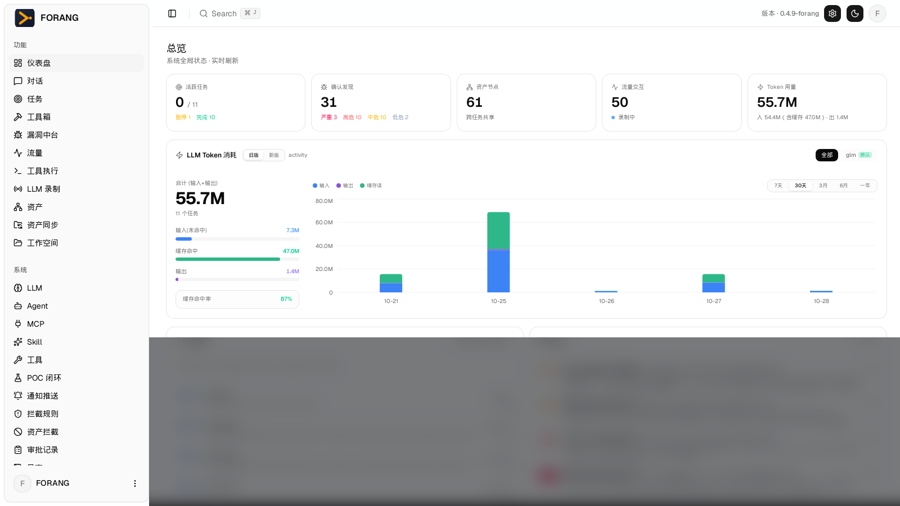
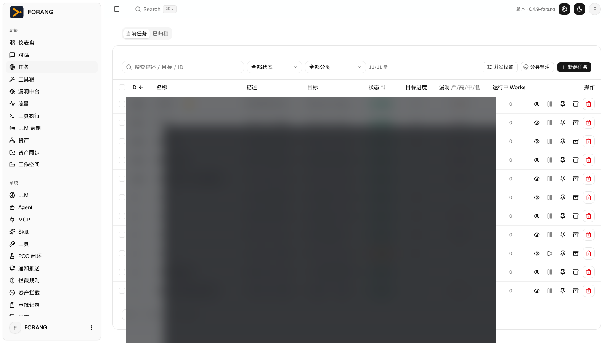
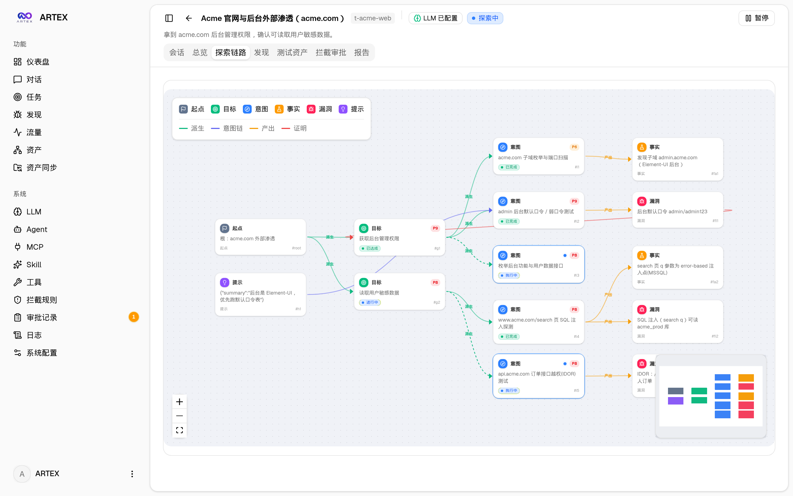
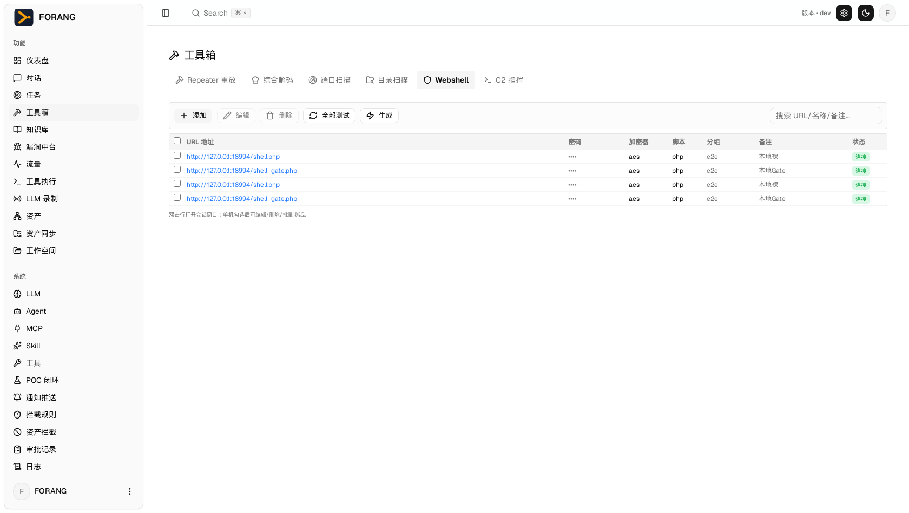
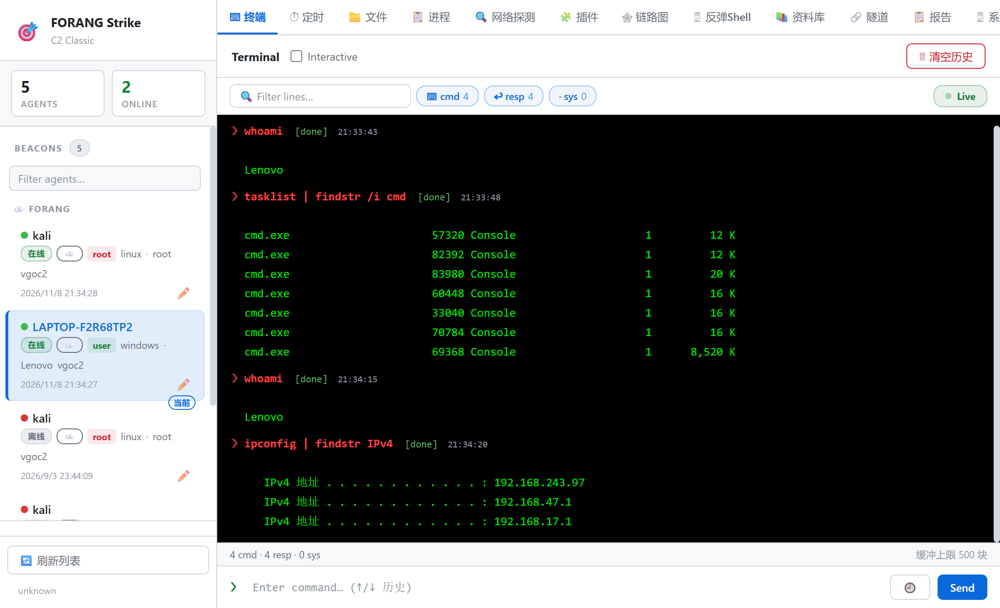
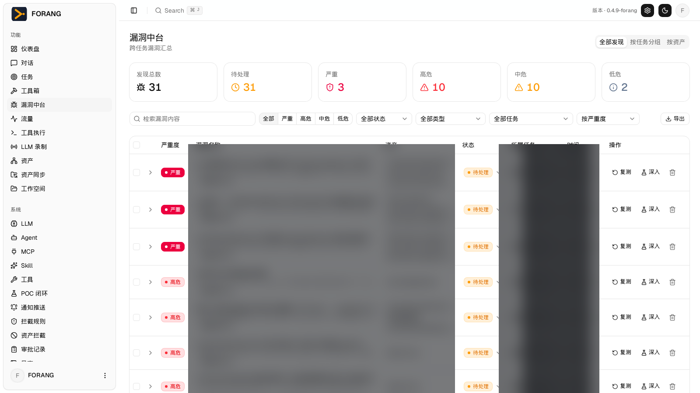
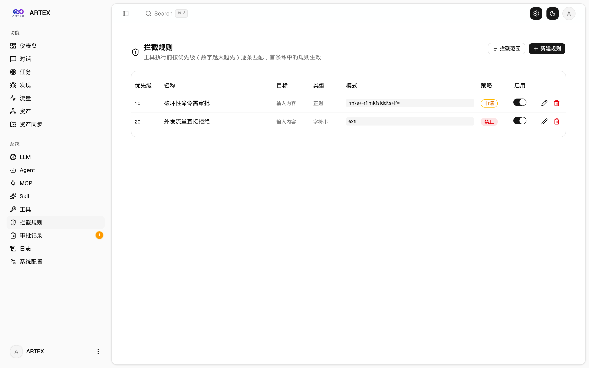
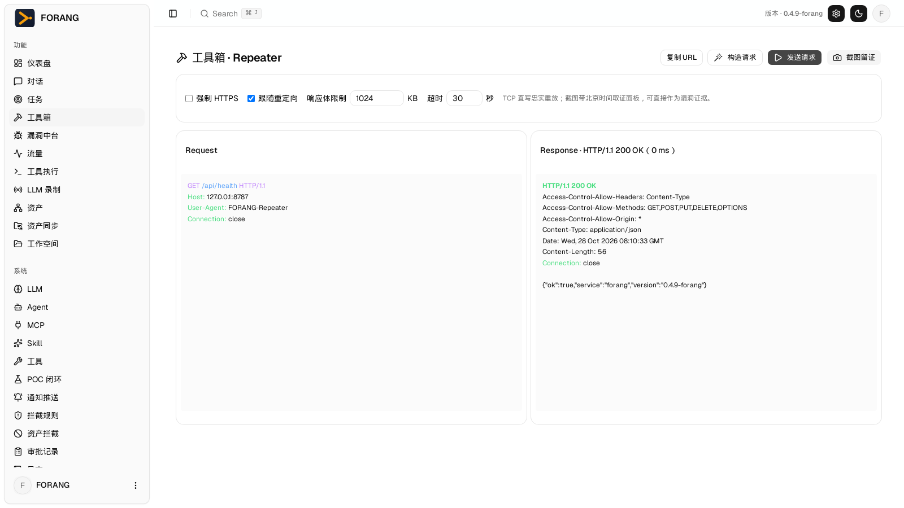
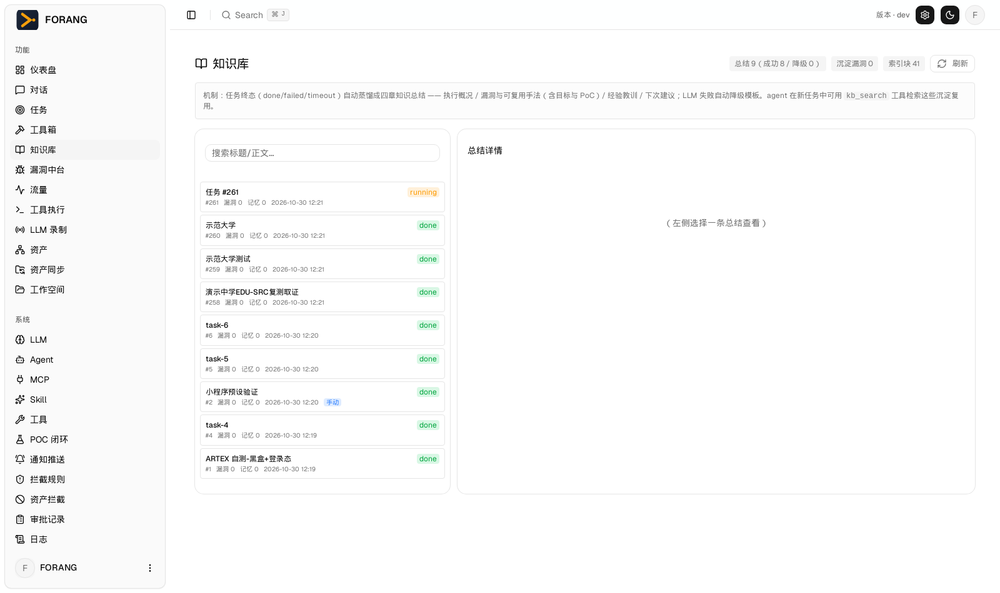

# FORANG — AI 自动化渗透平台

<p align="center">
  
  
  
  
  
  
  
</p>

**多 Agent 协同的 AI 自动化渗透平台**：planner 拆解目标、worker 驱动 40+ 工具真实进攻、监督员实时纠偏，在授权边界内自动完成 **侦察 → 漏洞发现 → 利用拿权 → Webshell 落地 → C2 控制 → 取证报告** 全链路。单条命令从指纹识别一路打到 root 回显，**每一步攻击动作都在链路图上留痕、进报告**。

> Go 单二进制（内嵌前端）+ PostgreSQL，Docker Compose 一键部署；Webshell 管理器字节级兼容蚁剑/冰蝎/哥斯拉三协议，C2 指挥台对标 Cobalt Strike 作业习惯。

> **合规声明**：本平台仅用于**已授权**的安全测试（渗透测试 engagements、护网、SRC、CTF、自有资产巡检）。内置规则拦截 + LLM 裁判审批 + 人工审批三档管控与全量审计，使用者仍需自行确保测试行为获得书面授权。

---

## ✨ 核心亮点

- 🧠 **LLM 是渗透引擎，不是聊天窗口** — planner / worker / supervisor 多 Agent 协同：目标自动拆解为意图链，worker 领取意图驱动真实工具进攻，探索链路图（目标→意图→事实→漏洞）全程持久化，`steer_work` 运行中实时纠偏不打断。
- ⚔️ **攻击动作全链入图，进攻过程可审计** — 侦察（指纹/端口/目录扫描）、突破（免杀马生成/上传落地/命令执行）、控制（C2 指挥/Beacon 部署）每一类动作自动写成链路图一等节点，连失败尝试都留痕；Word / Markdown 报告自动生成「攻击动作痕迹」时间线 —— **webshell 落地了吗、什么时候、哪条命令拿到 root，报告里逐条可查**。
- 🐉 **Webshell 管理器（哥斯拉式作业习惯）** — 蚁剑 raw / 冰蝎 aes / 哥斯拉 xor 三协议**加密字节级兼容**（与原版实现逐字节回归断言）；L0/L1/L2 三级免杀生成（函数拆分/临时文件 include 链/垃圾膨胀/API 替换），对真实 ClamAV+YARA 引擎验证；Tomcat Filter 内存马注入/枚举/移除全生命周期；会话工作台含文件管理、数据库、内网代理、截屏。
- 🕹️ **C2 指挥台（CS 式作业习惯 + Classic 控制台双形态）** — 对接自研 goc2 teamserver（Go 单二进制）：**Classic 控制台** 12 面板（终端/定时/文件/进程/网络探测/插件/攻击链路图/反弹 Shell(PTY)/资料库/隧道/报告/系统信息），SSE 实时回显；**Windows 全面板原生适配**（GBK 输出转码 / 引号安全 stdin 注入 / CREATE_NO_WINDOW 零弹窗 / -H windowsgui 零黑框，CS/vshell 式无窗体验）；**载荷工程 9 平台格式**（win exe/x86/DLL/garble 混淆、linux elf/arm64/g、macOS 双架构）+ **T0/T1/T3 免杀加载器**（随机密钥 + IPv4 混淆 + ETW/AMSI 补丁 + NTDLL 脱钩 + AI 源码级多态变形编译验证）；回连地址自动解析 + 云部署手动覆盖；SOCKS5 隧道 / 端口转发 / AI 一键内网穿透；**AI 自动驾驶**持续「分析→决策→执行」循环；上线钉钉/飞书实时推送。
- 🔗 **漏洞发现 → 拿权 → 控制，一条链自动打通** — `auto_escalate` 复合工具四场景联动：发现上传漏洞即自动生成免杀马、部署、PONG 验证、执行 `id` 拿真实回显、入库 Webshell 管理器；发现命令执行直连验证；已有 Webshell 可一键升级 C2 Beacon。指纹识别命中组件即自动匹配 POC 库并联动创建渗透任务。
- 🛡️ **AI 审批监管：AI 管 AI** — 未命中规则的工具调用交由**裁判小模型**实时审查（D1-D6 破坏判据 / A1-A6 放行判据 / 判不准转人工），judge 失败 fail-closed；监督员定时巡视活动流注入避险建议（guarded/offensive/stealth 等五策略）；人工审批队列 + 全量调用流水 + 真实拦截率统计。
- 🔍 **源码审计（静态，不出网不执行）** — 上传源码 zip（流式 2GB + 防 zip bomb/路径穿越），AI 多 Agent 只读审计（Read/Grep/Glob 工具面按任务收口：无 Bash/无出网/无攻击工具）：接口清点与权限判定（公开/登录/管理员/内部接口）、SQL 注入/命令执行/SSRF/路径穿越/硬编码凭据，每条漏洞带 文件:行号 + 代码片段，数据流三步确认（参数可控→校验缺失→到达 Sink）+ 对抗式自检降误报。实测自建漏洞源码包 6/6 全检出。
- 📦 **批量资产渗透** — 多目标一次导入 → 并发指纹识别 → 每目标自动生成独立 AI 任务（指纹注入任务目标）→ 并发槽位调度并行执行 → 战役级汇总（完成度/漏洞数/critical 数）；指纹三路入库：资产表 + 字典中心 + 知识库经验。
- 🌱 **越用越强的知识体系** — 任务终态自动蒸馏四章节总结入知识库（bigram 检索跨任务复用，下个同类目标直接继承经验）；六类字典（路径/用户名/密码/参数/子域/**指纹**）扫描命中自动回灌，生长式进化；Token 成本治理：关键字预过滤 + KB/计划缓存，实测节省 45+ 次冗余 LLM 调用。
- 📊 **漏洞中台 + 行业格式报告** — 每条发现自动 CVSS 评审定级、复测闭环（确定性重放比对自动判定已修复/仍在）、IM 高危推送；行业交付模板：封面/资产/方法论/漏洞字段版式/**攻击动作痕迹**/加固建议，Word 自动嵌留证截图（实测 19 图 2.6MB 报告）。

---

<p align="center">
  
</p>
<p align="center"><sub>实时仪表盘：作战态势 / Token 消耗 / 缓存命中 / 任务与漏洞统计</sub></p>

## 界面预览

> 截图数据已演示化/打码处理。

| | |
| :---: | :---: |
| **任务列表**（多 Agent 任务 / 批量创建 / 探索图入口） | **探索链路图**（目标→意图→事实→漏洞→<b>攻击动作</b>） |
|  |  |
| **Webshell 管理器**（哥斯拉式目标表 + 会话工作台） | **C2 Classic 控制台**（12 面板：终端/文件/进程/网络/插件/链路图/反弹Shell/资料库/隧道/报告） |
|  |  |
| **漏洞中台**（评审 / CVSS / 复测 / 导出） | **审批与审计**（AI 裁判判决 + 调用流水 + 真实拦截率） |
|  |  |
| **工具箱 · Repeater**（原始报文重放 + 取证截图） | **知识库 · 字典中心**（蒸馏总结 + 六类生长字典） |
|  |  |

---

## 全链路实测（三靶场，非摆拍）

一次批量任务，平台自动完成：

```
批量导入 3 靶场 → 并发指纹识别（PHP/React、Apache/SpringBoot、Java/Nacos）
  ↓ 每目标自动生成 AI 渗透任务，并行执行
端口扫描 9 开放端口 · 目录扫描 723 路径 · 指纹入字典库
  ↓
漏洞发现 9 条（6 critical：无限制上传 RCE / 未授权命令执行 / Nacos 默认凭据）
  ↓ auto_escalate 自动升级
生成 php/aes 免杀 Webshell → 上传落地 → PONG 存活探测 → id 执行
  → uid=0(root) 真实回显 → 自动入库 Webshell 管理器（真实密码/编码）
  ↓
每一步写入探索链路图动作节点（含失败尝试）→ Word 报告「攻击动作痕迹」16 条时间线
  ↓
全程 AI 审批监管：10800 次工具调用，23 次高危动作被拦截（rm -rf / DELETE / TRUNCATE）
```

Token 消耗全程可查（每任务 2~4M input tokens、100~180 次 LLM 调用），KB 自动蒸馏沉淀。

---

## 核心能力

| 板块 | 能力 |
|---|---|
| 🔍 **源码审计** | zip 流式上传（2GB/防穿越/防 bomb）· 工具面按任务收口（不出网不执行）· 接口+权限判定入资产图 · 带行号证据漏洞 · 与漏洞中台/报告全链路复用 |
| 🎯 **AI 渗透引擎** | planner/worker/supervisor 多 Agent 协同 · 探索链路图持久化 · 运行中纠偏（steer_work）· 目标/约束运行时注入 · 预算与收尾 · 任务容器化（可选 kali 容器隔离 Bash）· 批量资产战役 |
| 🗺️ **攻击动作留痕** | 侦察（指纹/端口/目录）→ 突破（免杀马/上传/命令执行）→ 控制（C2/Beacon）八类动作节点入图 · 播报板时间线 · 报告动作痕迹章节 |
| 🐉 **Webshell 体系** | 蚁剑/冰蝎/哥斯拉三协议字节级兼容 · 7 语言生成器 · L0/L1/L2 免杀（真实 AV 引擎验证）· Tomcat 内存马全生命周期 · 会话工作台（文件/数据库/内网/截屏/PHP 工具）· Header Gate 防扫 |
| 🕹️ **C2 指挥** | goc2 teamserver（Go 自研）· CS 式指挥台 + Classic 12 面板控制台 · Windows 全适配（GBK 转码/stdin 注入/零窗口）· 载荷 9 平台（exe/DLL/garble/elf/macOS）· T0/T1/T3 免杀加载器 + AI 多态变形 · 反弹 Shell(ConPTY) · 资料库 · SOCKS5/端口转发 · AI 自动驾驶 · 插件系统 · 上线 IM 推送 · 审计防篡改（链式哈希） |
| 🛡️ **审批监管** | 规则引擎（allow/deny/ask）· LLM 裁判兜底（fail-closed）· 人工审批队列 · 监督员五策略巡视 · 资产黑名单 · 全量调用流水 · 真实拦截率 |
| 🌐 **三端渗透** | Web / 小程序（wxapkg 反编译解析）/ APP（APK/IPA 静态 + 模拟器动态 + frida 脱壳 Hook + 代理抓包建模）三端预设 Agent |
| 🔧 **独立模块** | C2 指挥（Classic 控制台）与 Webshell 管理器独立一级导航 · 工具箱保留 Repeater 重放+取证截图 · 端口/目录扫描 · CyberChef 中文版 · MuMu 模拟器 |
| 📊 **漏洞中台** | 自动 CVSS 评审 · 复测闭环 · 流量快照 · 证据绑定 · 行业格式 Word 报告嵌图 · Markdown 导出 |
| 🌱 **知识体系** | 任务蒸馏总结 · 跨任务经验复用 · 六类生长字典（含指纹）· dict_query 供 Agent 复用 · 导出 hydra/dirsearch 格式 |
| 🚦 **基础设施** | 流量录制代理（全任务报文入库检索）· SSE 实时推送 · 备份恢复（7 类数据 JSON 导出/导入）· 一键更新 · 隐身入口（防测绘指纹）· 代理订阅出口轮换 |

## 快速开始

### Docker Compose（推荐）

```bash
git clone https://github.com/F0ran9/forang.git
cd forang
cp .env.example .env    # 设置 POSTGRES_PASSWORD
docker compose up -d
# 浏览器打开 http://localhost:8787 初始化管理员密码
```

### 宿主机二进制

依赖：Go 1.26.3+、Node 20+、PostgreSQL 16+。

> LLM 图片块扩展（留证截图视觉自检）依赖本项目的 norma 分支：
> ```bash
> git clone -b image-blocks https://github.com/F0ran9/Norma.git ../norma
> ```
> go.mod 已 `replace github.com/Autumn-27/norma => ../norma`。

```bash
# 国内网络建议先配置镜像加速：goproxy.cn / npmmirror / registry-mirrors
cd web && npm ci && NEXT_EXPORT=1 npx next build && cd ..
rm -rf server/webui/dist && cp -r web/out server/webui/dist
go build -tags embedui -o forang ./cmd/artex
./forang -addr :8787 -proxy 127.0.0.1:8788
```

首次登录后在 **系统 → LLM** 配置模型（兼容 OpenAI / Anthropic 协议），即可创建第一个渗透任务。

## 典型工作流

```
⓪ 源码审计      上传 zip → 静态审计（可选独立线，产出直接进漏洞中台）
① 资产导入      批量创建 / 资产测绘（FOFA/Quake/Hunter）/ 三端载体上传
② 指纹联动      自动识别技术栈 → 匹配 POC 库 → 注入知识库经验 → 生成任务
③ AI 渗透      planner 拆目标 → worker 进攻（扫描/利用/留证）→ 监督员纠偏
④ 拿权升级      auto_escalate：免杀 Webshell 落地 → 命令执行 → C2 Beacon
⑤ 中台治理      CVSS 自动评审 → 证据绑定 → 复测闭环 → IM 推送
⑥ 交付沉淀      行业格式 Word 报告（嵌截图+攻击动作痕迹）→ KB 蒸馏复用
```

## 架构

```
┌─────────────────────────── FORANG 单二进制 ───────────────────────────┐
│  Next.js 静态导出（内嵌）         流量录制代理 :8788                    │
│  ┌──────────────────────────┐   ┌──────────────────────────────┐     │
│  │ Web :8787（SSE 实时推送） │   │ 全任务 HTTP 报文入库检索      │     │
│  └────────────┬─────────────┘   └──────────────────────────────┘     │
│               │                                                        │
│  ┌────────────▼─────────────────────────────────────────────┐        │
│  │ 渗透引擎：planner ⇄ worker ⇄ supervisor（guard 拦截+裁判）│        │
│  │   探索图（目标/意图/事实/漏洞/动作） · 并发槽位 · 预算       │        │
│  └────┬───────────────┬───────────────┬───────────────┬─────┘        │
│    40+ Agent 工具   Webshell 体系    C2 桥(goc2)      工具箱          │
│  (扫描/指纹/POC/    (三协议/免杀/    (Console/隧道/   (Repeater/      │
│   auto_escalate     内存马)          自动驾驶)        取证截图)        │
│               │                                                        │
│  PostgreSQL：任务 · 探索图 · 漏洞中台 · 知识库 · 字典 · 审计            │
└───────────────────────────────────────────────────────────────────────┘
```

## 版本

当前 **v0.5.65**（2026-11-12，见 [Releases](https://github.com/F0ran9/forang/releases)）。近期重点：

- **Webshell 双载体（脚本 + Java 动态载荷）**：Java 载体源码进仓库、首次调用 `javac --release 8` 运行时编译（不内置 .class），只发字节码给 JSP 载体 `defineClass`，目标端没有脚本引擎也能用；插件面与脚本载体对齐——数据库直连（支持 classpath 外驱动 `jar_path`）、内网端口扫描、进程/连接枚举（不依赖 netstat/tasklist）、Servlet/Filter 枚举、jar 动态装载、远程截屏、zip/unzip（带 Zip Slip 防护）
- **内存马跨容器**：Tomcat（FilterDef/FilterMap 注册）、Jetty 9.4/10/11（ServletHandler `_filters` + 链缓存失效）实测可用，门禁头触发、可列出、可卸载；Undertow 这类容器实测拒绝运行期注册 Filter（UT010041）会**如实报错**而不是假装成功

- **C2 Classic 控制台**：12 面板（终端/文件/进程/网络探测/插件/链路图/反弹 Shell/资料库/隧道/报告/系统信息/定时），SSE 实时回显，全动作入攻击链路图
- **Windows 全面板适配**：GBK 输出转码、引号安全 stdin 注入、CREATE_NO_WINDOW 零弹窗、GUI 子系统零黑框——CS/vshell 式无窗体验
- **免杀载荷工程**：9 平台格式（win exe/x86/DLL/garble、linux elf/arm64/g、macOS 双架构）、T0/T1/T3 加载器（随机密钥/IPv4 混淆/ETW+AMSI 补丁/NTDLL 脱钩）、AI 源码级多态变形（编译验证失败回退）、回连地址自动解析+云部署手动覆盖
- **源码审计**：zip 上传 → AI 静态审计 → 带行号证据漏洞（v0.5.9）
- AI 审批监管（LLM 裁判 + 监督员 + 真实拦截率口径）· 批量资产渗透 · 侦察三件套 Agent 工具化
- **平台自身安全自审（全平台白盒 + 黑盒）**：SQL 拼接/命令执行/SSRF/文件读取/zip-tar 解包/JWT 密钥管理/前端 sink 全量白盒清点 + 动态渗透（未授权矩阵 17 端点全 401 / 路径遍历 / SQLi 探针 / 存储型 XSS 注入浏览器断言 / 畸形文件抗性）——修复报告渲染 XSS（DOM 级净化器）与 SSE 裸 JWT（一次性票据化），补齐 XFO/nosniff/Referrer-Policy 安全响应头；Playwright 全站 22 页用户视角走查零错误
- Webshell 管理器 / 知识库 / 字典中心（详见 [提交历史](https://github.com/F0ran9/forang/commits/main)）

## 安全与合规

平台仅用于**授权范围内**的安全测试。内置：授权承诺确认、规则拦截、LLM 裁判审批（fail-closed）、人工审批队列、监督员巡视、操作约束注入、破坏性命令拦截、审计防篡改（链式哈希）、最小影响原则条令。对未授权目标使用本平台造成的后果由使用者自行承担。

## 致谢与许可

- 基于 [ARTEX](https://github.com/Autumn-27/artex)（AGPL-3.0）二开，上游 README 见 [README-ARTEX-upstream.md](README-ARTEX-upstream.md)。
- 审批治理 / 发包留证 / 监督模式等方法论参考 [Full-Chain-Sentinel-System](https://github.com/zgsfsec/Full-Chain-Sentinel-System)（MIT）。
- Agent 运行时 [norma](https://github.com/Autumn-27/norma)。
- 许可证：AGPL-3.0（见 LICENSE）。

<!-- ver-note -->
> v0.5.65：zip/unzip 失败回显带原因与路径，空包/非 zip 不再回 OK 0。
> v0.5.64：PHP 载体 zip/unzip 与 Java 对齐（空目录保留、解包挡越界条目）。
> v0.5.63：控制台新增「压缩解压」面板（目标机内打包/解包，PHP 与 Java 载体共用，目标路径可自动推导）。
> v0.5.62：Java 载荷补齐 zip/unzip（流式打包、空目录保留、解包挡 Zip Slip），双载体插件面对齐。
> v0.5.61：Java 载荷补 Servlet/Filter 枚举、jar 动态装载、远程截屏；`db` 支持 classpath 外驱动（绕过 DriverManager 直连）。
> v0.5.60：内存马跨容器（Tomcat/Jetty 9.4+10/11）+ Agent 后渗透 playbook；进程/连接枚举不再受 500 条上限假阴性影响。
> v0.5.58：全平台白盒+黑盒安全自审结论落档（存储型 XSS 净化 / SSE 一次性票据 / 安全响应头 + CSP frame-ancestors 兼容同源 iframe）、Playwright 全站 22 页走查；README 版本与技术栈口径统一，新增 Star History 动态曲线。
> v0.5.50：C2 Classic 控制台（12 面板）+ Windows 全面板适配 + 免杀载荷工程（9 平台/AI 多态）+ 回连地址覆盖；C2 指挥 / Webshell 拆独立一级模块。
> v0.5.23：release 产物与自更新资产全面更名 forang-*；一键更新解包双名兼容（前向 forang、回滚 artex）。

---

## ⭐ Star History

<p align="center">
  <a href="https://star-history.com/#F0ran9/forang&amp;Date">
    
  </a>
</p>
<p align="center"><sub>图表由 star-history.com 实时生成 · 点击可查看交互版</sub></p>
